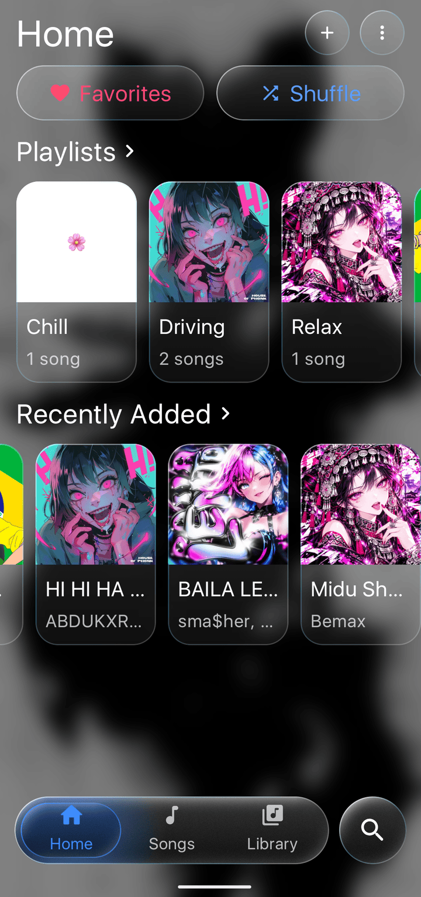
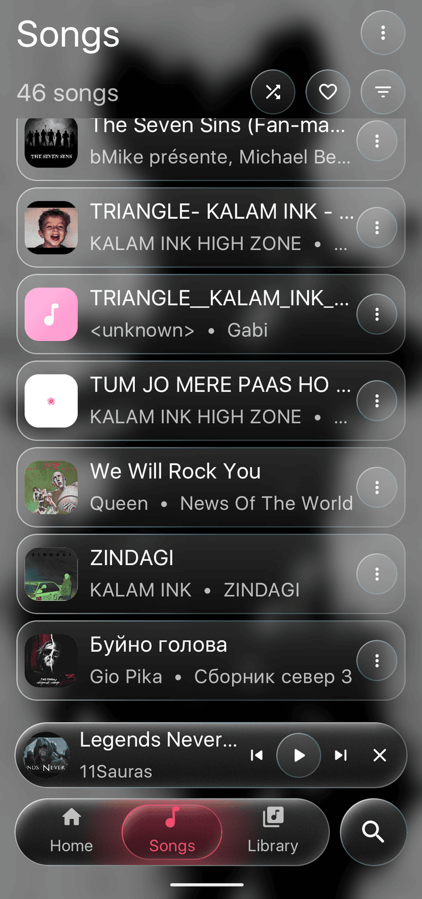
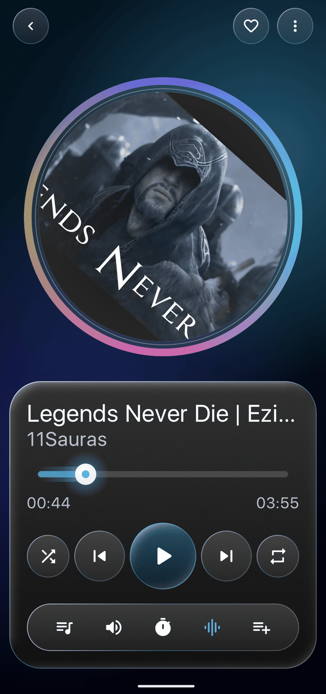
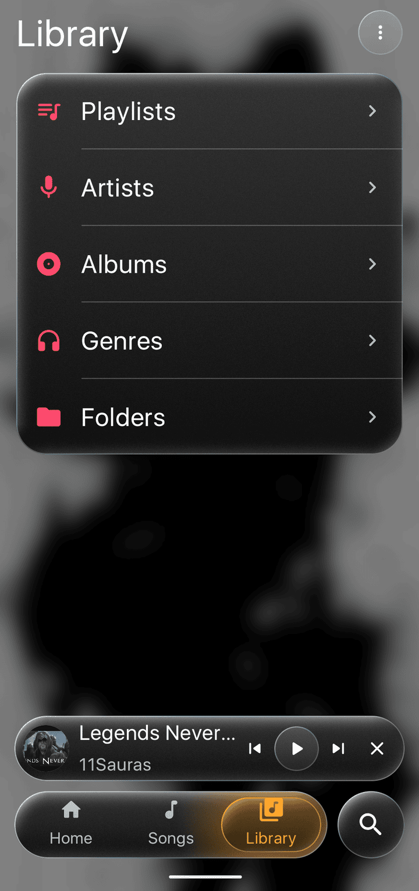
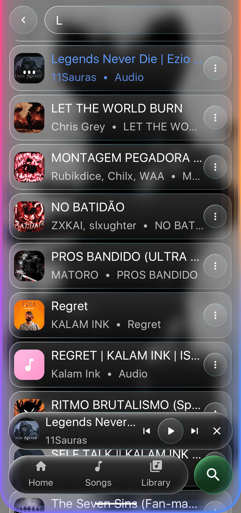
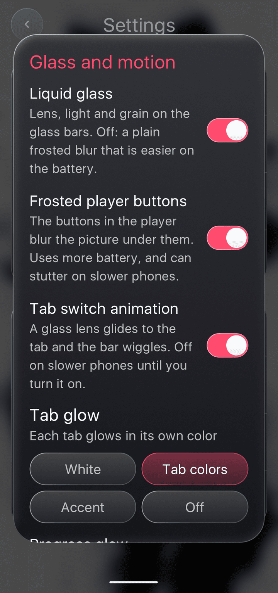
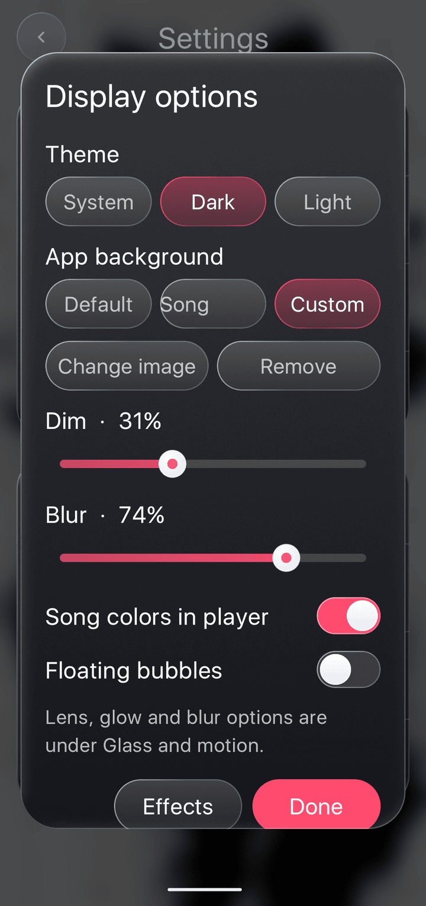
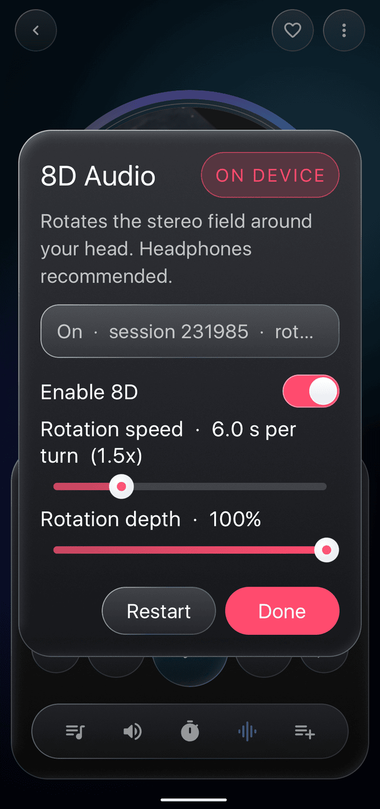
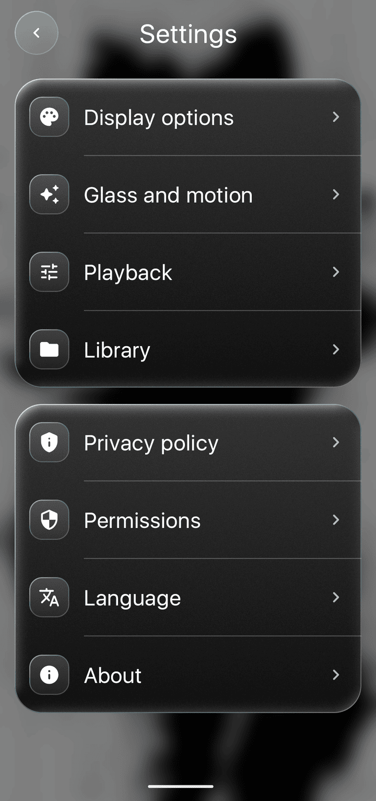

# Glass Player

Local music player for Android with a real liquid-glass UI (dark + light), built with Kotlin, Jetpack Compose and Media3.

## Screenshots

| Home | Songs | Player |
| :---: | :---: | :---: |
|  |  |  |
| **Library** | **Search** | **Effects** |
|  |  |  |
| **Display options** | **8D audio** | **Settings** |
|  |  |  |

## Build

### Requirements
- Android Studio Koala or newer (or Gradle 8.7+ CLI)
- JDK 17
- Android SDK with API 35 platform installed

### Steps
1. Open the `GlassPlayer` folder in **Android Studio**.
2. Let Gradle sync, then **Run** on a device or emulator (Android 8.0+, API 26).
3. Grant the audio permission on first launch.

Command line:
```bash
./gradlew assembleDebug
```

### GitHub Actions
A workflow is included at `.github/workflows/build.yml`. Push a tag like `v1.0` to trigger an automatic build and release the APK on the GitHub Releases page. You can also trigger it manually from the Actions tab.

### Build notes
- The `AppViewModel` uses `@JvmName` annotations on setter methods to avoid JVM signature clashes with Kotlin's auto-generated property setters.
- The AGSL shader in `LensFx.kt` uses distinct variable names (`n` for the normal vector, `gn` for film grain noise) to avoid redeclaration errors.

## Liquid glass

Glass surfaces refract what is actually behind them instead of just being translucent.

- The app records its content into `GraphicsLayer`s in three tiers (`MainActivity.kt`):
  background only (cards and rows), background + screens (nav bar and mini player, so lists blur as they scroll under), and the whole scene (popup menus and dialogs).
- `Glass()` in `ui/GlassTheme.kt` draws the right tier behind itself with a `RenderEffect`.
  - **Android 13+**: blur + AGSL lens shader (`ui/LensFx.kt`) with edge bend, slight chromatic dispersion, saturation boost and specular rim.
  - **Android 12**: blur only.
  - **Older**: translucent gradient fill.
- Settings > Display options > **Glass effect**: Full / Soft / Off (Off is lightest on battery).
- Popup menus and dialogs are drawn inside the app (not system windows), so they refract the screen and animate (`ui/Popups.kt`, `ui/Dialogs.kt`).

## Backgrounds (Settings > Display options)

- **Default**: dark/light gradient with drifting bubbles.
- **Song colors**: gradient built from the playing song's artwork (Palette), smoothly cross-faded between tracks; accent colour follows too.
- **Custom**: pick any image; it is downscaled and stored privately. Dim and blur sliders.
- **Song colors in player**: Now Playing always uses the artwork palette (toggle).

## Glass and motion (Settings > Glass and motion)

- **Liquid glass**: Full (lens + grain) / Soft (blur) / Off.
- **Frosted player buttons**: Now Playing controls sit on frosted glass.
- **Tab switch animation**: the glass lens springs to the selected tab and the bar wiggles.
- **Tab glow**: White / Tab colors (Home blue, Songs pink, Library amber, Search green) / Accent / Off. The glow blends while the lens glides.
- **Progress glow**: light along the played part of the seek bar and a halo at the thumb.
- **Search glow**: soft rainbow light around the screen edges on Search (`ui/Glow.kt`).

## Animations

Directional screen transitions, sliding nav indicator, springy press feedback on every glass control, liquid switch and slider, staggered popup items, mini-player slide in/out, title swap, rotating record artwork, equalizer bars on the playing row, heart bounce, drag-to-dismiss player.

## What's inside

| Area | Details |
|---|---|
| Screens | Home, Songs, Library (Playlists / Artists / Albums / Genres / Folders), Search, Now Playing, Settings |
| Overlays | 8D Audio, sleep timer, volume, queue, add to playlist, display/playback/library options, about |
| Playback | Media3 ExoPlayer in a `MediaSessionService` (background play, notification, lock-screen and headset controls) |
| 8D audio | On-device `AudioProcessor` (`playback/EightD.kt`): equal-power pan rotating around the head plus rear low-pass |
| Data | MediaStore scan; favorites and playlists stored locally. No network permission |

## Layout

```
app/src/main/java/com/glassplayer/app/
  AppViewModel.kt          navigation, library, playback, 8D, backgrounds, song colours
  MainActivity.kt          app root, glass backdrop tiers, transitions, back handling
  data/                    models, MediaStore scan, local store, SongColors
  playback/                PlaybackService, EightDAudioProcessor
  ui/GlassTheme.kt         palettes, Glass surface, backdrop recording
  ui/LensFx.kt             AGSL refraction shader
  ui/Popups.kt             glass popup menu
  ui/Backgrounds.kt        default / song / custom / player backgrounds, bubbles
  ui/ColorExtract.kt       artwork palette extraction
  ui/Glow.kt               tab colours, search edge glow
  ui/Controls.kt           glass switch and slider
  ui/Components.kt         buttons, rows, mini player, nav bar
  ui/Screens.kt            Home, Songs, Library, lists, detail, search, settings
  ui/NowPlaying.kt         full-screen player
  ui/Dialogs.kt            all dialogs
```

## Notes
- Many blurred surfaces cost GPU. On a slow device use Display options > Glass effect > Soft or Off.